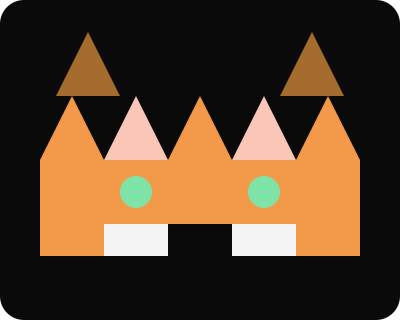
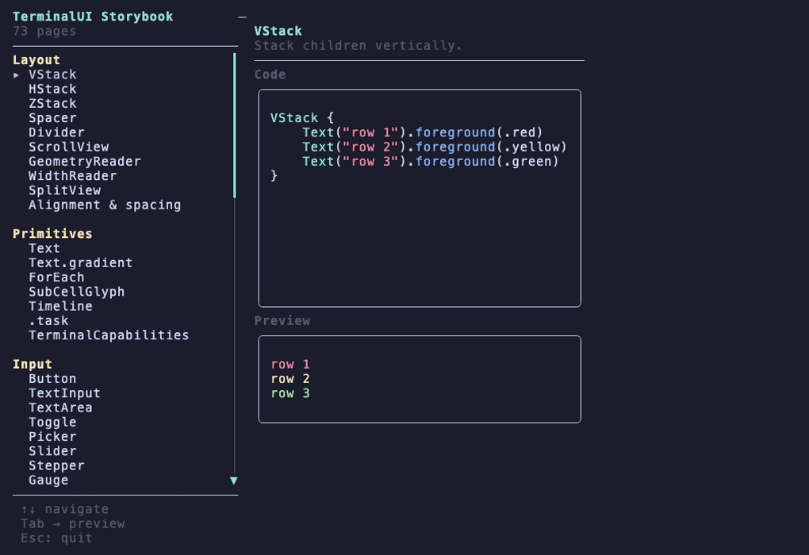
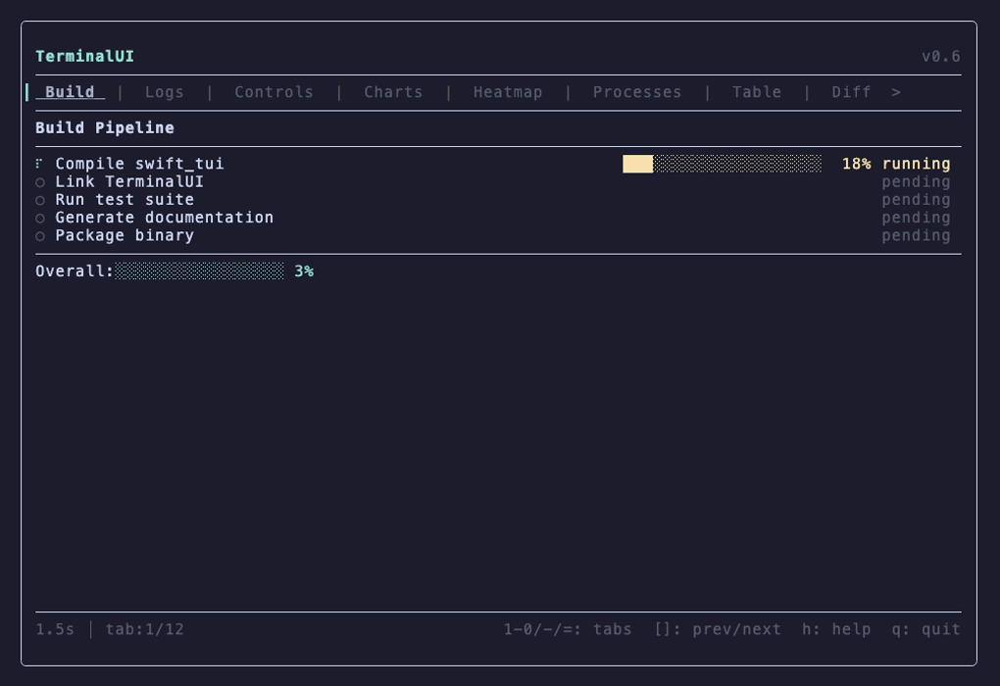
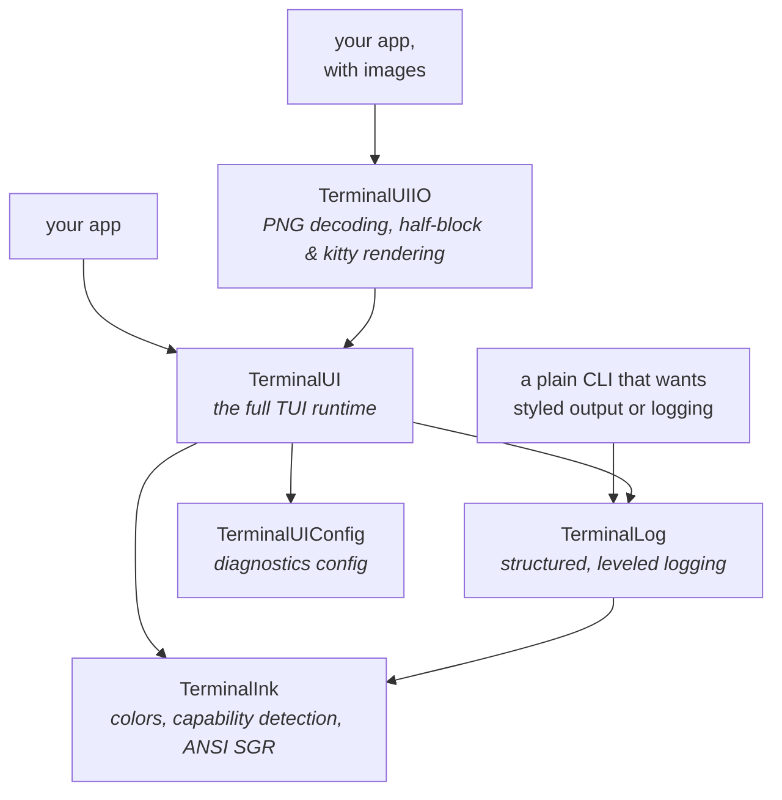

<p align="center">
  
</p>

<h1 align="center">TerminalUI</h1>

<p align="center">A SwiftUI-paradigm framework for building terminal applications in Swift.<br/>macOS and Linux. Zero dependencies.</p>

<p align="center">
  <a href="https://github.com/dardevelin/terminal-ui/actions/workflows/ci.yml"></a>
  <a href="https://github.com/dardevelin/terminal-ui/actions/workflows/docs.yml"></a>
  <a href="https://github.com/dardevelin/terminal-ui/releases"></a>
  
  
  
</p>

---

```swift
import TerminalUI

@main
struct Hello: TerminalAppProtocol {
    static func content() -> some TerminalView {
        VStack {
            Text("Hello from TerminalUI").bold()
            Divider()
            Text("Press q to quit.").foreground(.gray)
        }
    }
}
```

`swift run` starts this as a raw-mode terminal app with keyboard and mouse
input, resize handling, and frame-capped rendering.

<p align="center">
  
</p>
<p align="center"><sub>The <code>Storybook</code> example app — one page per public
API. Recorded with <a href="https://github.com/charmbracelet/vhs">vhs</a>;
the script is <code>assets/demo.tape</code>.</sub></p>

## Design

TerminalUI follows SwiftUI's model instead of defining its own: declarative
`some TerminalView` bodies, stack-based composition, `@Observable` state
driving re-renders, `Binding`, environment values, and view modifiers. The
intent is that existing SwiftUI knowledge transfers directly — the difference
is that views render into terminal cells rather than pixels, and the runtime
is built around what terminals need (raw mode, escape-sequence input parsing,
delta output over possibly slow connections).

State changes drive rendering through a dirty-flag, so an idle app does no
work per frame. Each rendered frame is diffed against the previous one and
only changed cells are written — measured frame deltas over SSH are typically
69–111 bytes. Uncapped throughput measures ~82,000 fps idle and ~700 fps
active in release builds; the default mode caps at 60 fps, and an `.onDemand`
mode renders only on events.

## Deciding whether to use it

TerminalUI is a good fit when:

- **You already know SwiftUI.** The paradigm, property wrappers, and modifier
  chains transfer as-is; there is no separate widget/event vocabulary to learn.
- **You want a dependency you can audit.** Adding the package clones this
  repository and nothing else, at build time or runtime.
- **Your app runs over SSH or on constrained connections.** Delta output was
  measured, not assumed — see the numbers above.
- **You need the app to be drivable by tests or AI agents.** The debug build
  exposes a remote-control socket and cell-accurate screenshots
  (see [Debug tools](#debug-tools-and-agent-driven-development) below).
- **You target macOS and Linux from one codebase.** Both are exercised by the
  same test suite and the same PTY-driven behavioural harness.

It is the wrong fit when:

- You need **Windows** — not supported, and not currently planned.
- You can't require **Swift 6.2+ / macOS 15+** toolchains.
- Your users' terminals lack **truecolor** — 256/16-color downconversion is
  planned but not shipped, and colors currently degrade badly without it.
- You want a **curses-style imperative API** — the model here is declarative;
  the escape hatch (`BufferView`) exists but is not the paradigm.

## What's included

37 views and 7 chart components. Every name below links to its documentation,
and every one has a live page in the Storybook — `swift run Storybook` is the
animated version of this table.

| | Components |
|---|---|
| **Layout** | [`VStack`](https://dardevelin.github.io/terminal-ui/documentation/terminalui/vstack) · [`HStack`](https://dardevelin.github.io/terminal-ui/documentation/terminalui/hstack) · [`ZStack`](https://dardevelin.github.io/terminal-ui/documentation/terminalui/zstack) · [`Spacer`](https://dardevelin.github.io/terminal-ui/documentation/terminalui/spacer) · [`Divider`](https://dardevelin.github.io/terminal-ui/documentation/terminalui/divider) · [`ScrollView`](https://dardevelin.github.io/terminal-ui/documentation/terminalui/scrollview) · [`SplitView`](https://dardevelin.github.io/terminal-ui/documentation/terminalui/splitview) · [`GeometryReader`](https://dardevelin.github.io/terminal-ui/documentation/terminalui/geometryreader) · [`WidthReader`](https://dardevelin.github.io/terminal-ui/documentation/terminalui/widthreader) |
| **Content & data** | [`Text`](https://dardevelin.github.io/terminal-ui/documentation/terminalui/text) · [`MarkdownView`](https://dardevelin.github.io/terminal-ui/documentation/terminalui/markdownview) · [`CodeView`](https://dardevelin.github.io/terminal-ui/documentation/terminalui/codeview) · [`ForEach`](https://dardevelin.github.io/terminal-ui/documentation/terminalui/foreach) · [`List`](https://dardevelin.github.io/terminal-ui/documentation/terminalui/list) · [`Table`](https://dardevelin.github.io/terminal-ui/documentation/terminalui/table) · [`TabView`](https://dardevelin.github.io/terminal-ui/documentation/terminalui/tabview) · [`TreeView`](https://dardevelin.github.io/terminal-ui/documentation/terminalui/treeview) · [`DiffView`](https://dardevelin.github.io/terminal-ui/documentation/terminalui/diffview) · [`HunkDiffView`](https://dardevelin.github.io/terminal-ui/documentation/terminalui/hunkdiffview) · [`BufferView`](https://dardevelin.github.io/terminal-ui/documentation/terminalui/bufferview) · [`ProgressBar`](https://dardevelin.github.io/terminal-ui/documentation/terminalui/progressbar) · [`Gauge`](https://dardevelin.github.io/terminal-ui/documentation/terminalui/gauge) · [`Spinner`](https://dardevelin.github.io/terminal-ui/documentation/terminalui/spinner) · [`StatusBar`](https://dardevelin.github.io/terminal-ui/documentation/terminalui/statusbar) |
| **Input & forms** | [`Button`](https://dardevelin.github.io/terminal-ui/documentation/terminalui/button) · [`TextInput`](https://dardevelin.github.io/terminal-ui/documentation/terminalui/textinput) · [`TextArea`](https://dardevelin.github.io/terminal-ui/documentation/terminalui/textarea) · [`Toggle`](https://dardevelin.github.io/terminal-ui/documentation/terminalui/toggle) · [`Picker`](https://dardevelin.github.io/terminal-ui/documentation/terminalui/picker) · [`Slider`](https://dardevelin.github.io/terminal-ui/documentation/terminalui/slider) · [`Stepper`](https://dardevelin.github.io/terminal-ui/documentation/terminalui/stepper) · [`PromptInput`](https://dardevelin.github.io/terminal-ui/documentation/terminalui/promptinput) · [`Form`](https://dardevelin.github.io/terminal-ui/documentation/terminalui/form) · [`Section`](https://dardevelin.github.io/terminal-ui/documentation/terminalui/section) · [`LabeledContent`](https://dardevelin.github.io/terminal-ui/documentation/terminalui/labeledcontent) · [`NavigationStack`](https://dardevelin.github.io/terminal-ui/documentation/terminalui/navigationstack) · [`NavigationLink`](https://dardevelin.github.io/terminal-ui/documentation/terminalui/navigationlink) |
| **Charts** | [`BarChart`](https://dardevelin.github.io/terminal-ui/documentation/terminalui/barchart) · [`Sparkline`](https://dardevelin.github.io/terminal-ui/documentation/terminalui/sparkline) · [`HeatMap`](https://dardevelin.github.io/terminal-ui/documentation/terminalui/heatmap) · [`BrailleCanvas`](https://dardevelin.github.io/terminal-ui/documentation/terminalui/braillecanvas) · [`DotMatrixText`](https://dardevelin.github.io/terminal-ui/documentation/terminalui/dotmatrixtext) · [`DotFont`](https://dardevelin.github.io/terminal-ui/documentation/terminalui/dotfont) · [`MorseTicker`](https://dardevelin.github.io/terminal-ui/documentation/terminalui/morseticker) |
| **Presentation** | [`.alert`](https://dardevelin.github.io/terminal-ui/documentation/terminalui/terminalview) · [`.confirmationDialog`](https://dardevelin.github.io/terminal-ui/documentation/terminalui/terminalview) · [`.modal`](https://dardevelin.github.io/terminal-ui/documentation/terminalui/terminalview) — with focus containment |

Beyond the components:

- **Theming**: components draw semantic roles — `accent`, `foregroundMuted`,
  `errorSubtle`, ~30 in all — from the app's `Theme`. A theme states the
  colours it cares about and the rest are derived from them, so a brand
  palette restyles every component at once.
- **Markdown and code**: `MarkdownView` renders the CommonMark agents write,
  restyled through `MarkdownStyle`; `CodeView` and `TextArea` highlight
  source through registered lexers, coloured by the theme.
- **Text editing**: one readline keymap in every input — Ctrl+A/E/K/U/W/Y,
  Alt+B/F — that an app can rebind, and can let its users rebind.
- **Input**: SGR 1006 mouse (click, wheel, hover), modifier arrows,
  Option-as-Meta on macOS, bracketed paste, and the kitty keyboard
  protocol's key reports where the terminal sends them.
- **Focus**: independent keyboard and mouse focus, Tab cycling between areas,
  scope-aware arrow navigation, directional movement between panes.
- **Debug tooling**: in-app inspector, frame stats, and a remote-control
  socket — [its own section](#debug-tools-and-agent-driven-development).

## Install

Swift 6.2+. macOS 15+ or Linux. Resolving the package clones nothing else —
there are no transitive dependencies, including build-time ones.

**As a package dependency** (the normal path):

```swift
// Package.swift
dependencies: [
    .package(url: "https://github.com/dardevelin/terminal-ui", from: "2.0.0"),
],
targets: [
    .executableTarget(
        name: "YourApp",
        dependencies: [
            .product(name: "TerminalUI", package: "terminal-ui"),
        ]
    ),
]
```

**Vendored** — pin the source inside your repo (air-gapped builds, audit
requirements, or patch-and-carry):

```bash
git submodule add https://github.com/dardevelin/terminal-ui Vendor/terminal-ui
```

```swift
// Package.swift — a path dependency; product names stay the same
dependencies: [
    .package(path: "Vendor/terminal-ui"),
],
```

`swift build` treats the submodule exactly like a registry checkout, and your
lockfile stops caring about the network.

**Working on the framework itself**:

```bash
git clone https://github.com/dardevelin/terminal-ui
cd terminal-ui
swift test                 # the full suite
swift run Storybook        # every public API, one page each
```

Point an app at your clone with `.package(path: "../terminal-ui")` and edits
to the framework rebuild into the app on the next `swift run` — no publishing
step in the loop.

## A complete app

State lives in an `@Observable` class; mutating it triggers a render. Events
arrive in `onEvent`, and returning `false` quits.

```swift
import Observation
import TerminalUI

@Observable
final class Counter {
    var value = 0
}

// The framework calls onEvent and content() on the main thread; file-scope
// state with nonisolated(unsafe) is the pattern the bundled examples use.
nonisolated(unsafe) let state = Counter()

@main
struct CounterApp: TerminalAppProtocol {
    static func onEvent(_ event: TerminalEvent) -> Bool {
        if case .key(let keyEvent) = event {
            switch keyEvent.key {
            case .character("+"): state.value += 1
            case .character("-"): state.value -= 1
            case .character("q"), .escape: return false
            default: break
            }
        }
        return true
    }

    static func content() -> some TerminalView {
        VStack {
            Text("Counter").bold()
            Divider()
            Text("value = \(state.value)")
            Text("  +/-: change   q: quit").foreground(.gray)
        }
    }
}
```

## Example apps

| Command | What it shows |
|---|---|
| `swift run Storybook` | Every public API, one page each — the reference tour |
| `swift run Demo` | 12-tab showcase: charts, diff, tree, modals, focus scopes |
| `swift run ComponentsDemo` | Component gallery with realistic data |
| `swift run GitClient` | A small git client: staging list, hunk diff, commit prompt |
| `swift run Chat` | A chat interface: scrollback, prompt input, timed replies |
| `swift run Coder` | An agent-chat app in the shape of Crush: transcript, tool cards, diffs, sidebar |

A few more single-purpose targets live in `Examples/` (`AsyncState`,
`Navigation`, `Settings`, `DotMatrixDemo`); they double as fixtures for the
behavioural test harness.

## Debug tools and agent-driven development

Web development changed the day browsers shipped DevTools: inspect an
element, watch the console, drive the page from a script. Terminal apps
never got that — raw mode swallows the screen, and `print` debugging
corrupts the UI it's meant to inspect. TerminalUI brings the DevTools model
to TUIs. All of it is `#if DEBUG`-gated — release builds contain none of
this machinery.

<p align="center">
  
</p>
<p align="center"><sub>The debug tools opening in sequence — driven entirely
through the remote-control socket (<code>assets/debug.tape</code>), because
vhs can't press F-keys but <code>swtui ctl</code> can.</sub></p>

### Try it in sixty seconds

Run any example in a debug build:

```bash
swift run Demo
```

- **F1** — frame stats in the corner: fps, build/io time per frame, bytes
  written, dirty-cell percentage.
- **F2** — the debug panel: live graph tree, event and trace streams, a
  frame timeline.
- **F3** — the inspector: point it at any cell and the footer names the view
  that drew it, its rect, and its modifier chain — Inspect Element, for a
  terminal.

Then, from a second terminal, the same app over its socket:

```bash
swift run swtui ctl list                # every running debug app
swift run swtui ctl screenshot          # cell-accurate capture of the live app
swift run swtui ctl tree                # the current view hierarchy as JSON
swift run swtui ctl send-key down       # inject input
swift run swtui ctl send-text "hello"
swift run swtui ctl probe 12 4          # what view owns cell (12,4)?
swift run swtui ctl cells 0 0 40 10     # dump a region of the cell grid
```

This is what makes the framework practical for **agent-driven development**:
a coding agent (or a plain test script) can launch an app in a PTY, press
keys, read back the exact cell grid it produced, and assert on it — no OCR,
no screenshot diffing, no guessing. A typed Python client and PTY runner ship
in `tools/terminalui/`, and the repository's own behavioural suite is built
on them: it walks and verifies every Storybook page this way, on macOS and
on Linux.

The same machinery is why TUIs built on this framework can be **tested like
web apps**: deterministic cell-grid assertions instead of eyeballing a
terminal. That matters most for internal tooling — the software companies
run their engineering on, where a broken flow blocks a team and nobody
outside hears about it. A TUI whose features are pinned by real behavioural
tests keeps working release after release.

Diagnostics are configured per-project in `.terminalui/terminalui.toml`
(`swift run swtui init`), and every running app writes to its own
PID-isolated output directory, readable by you alone, so concurrent sessions
never collide.

## How rendering works

A `content()` body builds an immutable view value. The framework reconciles it
into an attribute graph with persistent node identity across frames and cached
layout. A renderer walks the graph via enum dispatch (no casts on the hot
path) into a cell buffer; a compositor diffs that buffer against the previous
frame and emits cursor moves plus writes only for changed cells, flushed in a
single POSIX `write` per frame. `@Observable` tracking means unchanged state
skips the entire pipeline.

## Documentation

The API reference and the architecture articles (the attribute graph, the
layout model, the performance history) are DocC, deployed to GitHub Pages on
every push to `main` by `.github/workflows/docs.yml`:

**<https://dardevelin.github.io/terminal-ui/documentation/terminalui/>**

To browse it locally with live reload while working on the docs:

```bash
tools/scripts/preview_docs.sh
```

This wraps `TUI_BUILD_DOCS=1 swift package --disable-sandbox
preview-documentation --target TerminalUI`, picking the next free port when
8080 is taken and shutting the server down cleanly however the script is
stopped — killing the bare `swift package` wrapper with anything but SIGINT
orphans the underlying `docc` server, which then squats the port.

The `TUI_BUILD_DOCS` gate exists because SwiftPM has no dev-only
dependencies — without it, every consumer of the package would clone the
DocC plugin to build a library that doesn't need it.

## Library products

One package, five products — consumers pull only the layer they need:



| Product | Depends on | Purpose |
|---|---|---|
| `TerminalUI` | Config, Ink, Log | The full TUI runtime described above |
| `TerminalInk` | — | Styled output alone: color model, terminal capability detection, ANSI SGR. For CLIs that want styled stdout/stderr without a render runtime |
| `TerminalLog` | TerminalInk | Structured logging with leveled colored prefixes; strips ANSI when output is not a TTY |
| `TerminalUIIO` | TerminalUI | Opt-in image rendering: PNG decoding, half-block and kitty renderers |
| `TerminalUIConfig` | — | Shared configuration for the debug/diagnostic system |

`import TerminalInk` in a script-sized CLI costs you the color layer and
nothing else; `TerminalUIIO` exists so apps without image needs never carry
decoders.

## Requirements & compatibility

- **Swift 6.2+** with `.swiftLanguageMode(.v6)` and `StrictConcurrency`
- **macOS 15+** or **Linux** (verified against the Docker `swift:6.2` image)
- Any VT100/ANSI terminal — exercised on iTerm2, Terminal.app, Alacritty,
  kitty, wezterm, tmux, and over ssh
- Truecolor output; 256-color and 16-color downconversion is planned

## Status

v2.0.1. 1543 tests in 301 suites, run on macOS and Linux, plus a PTY-driven
harness that walks every Storybook page and runs 129 behavioural cases
against the example apps, and a Thread Sanitizer build of both. Builds with
zero warnings under `-warnings-as-errors`, and every change is checked for
breaking the public API of the last release.

## How this was built

TerminalUI is developed in extensive collaboration with
[Claude Code](https://claude.com/claude-code). That is not incidental to the
design: the debug socket, the PTY harness, and the cell-grid assertions
described above are the loop the AI works in — it drives the running apps,
reads the frames back, and verifies its changes the same way any contributor
would. Direction, design taste, and acceptance stay human. If something in
here looks wrong, it probably is — please open an issue.

## License

TerminalUI is available under any of:

- Apache License, Version 2.0 ([`LICENSE-APACHE`](LICENSE-APACHE) or
  <http://www.apache.org/licenses/LICENSE-2.0>)
- MIT License ([`LICENSE-MIT`](LICENSE-MIT) or
  <http://opensource.org/licenses/MIT>)
- European Union Public Licence 1.2 ([`LICENSE-EUPL`](LICENSE-EUPL) or
  <https://joinup.ec.europa.eu/collection/eupl/eupl-text-eupl-12>)

at your option. Unless you explicitly state otherwise, any contribution you
submit for inclusion will be licensed as above without additional terms or
conditions.
